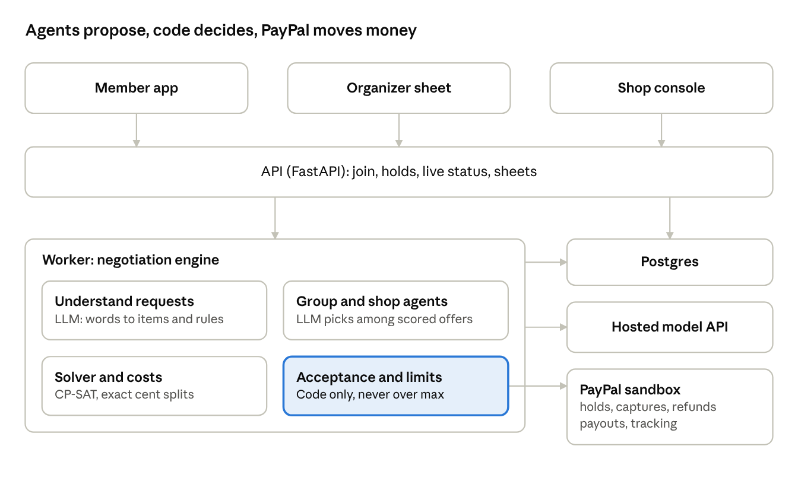
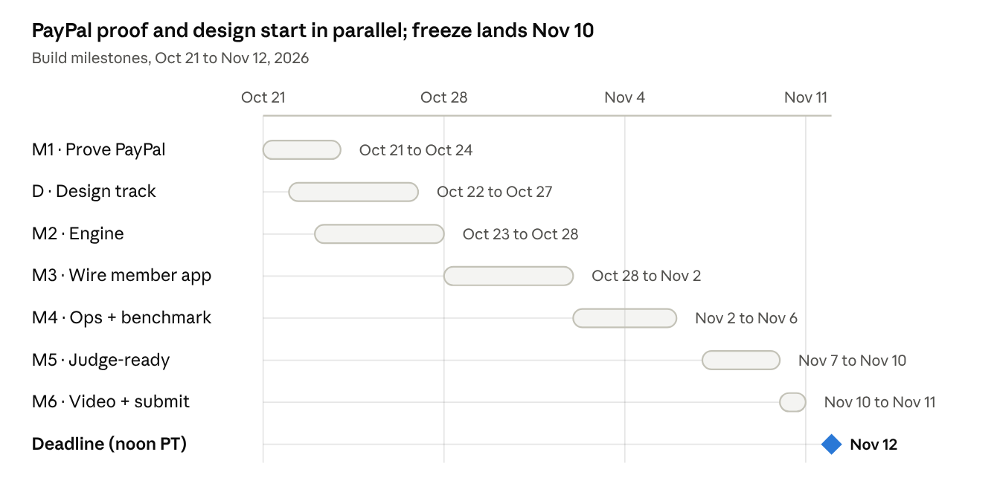

# Rally — build plan

> **v3, Oct 29 (owner-approved): shops bid for every item.** [docs/plan/BIDDING.md](docs/plan/BIDDING.md) replaces "Negotiation engine" below and updates the locked rows for the live deal, shopper rules, terms traded and model. Where they disagree, BIDDING.md wins.

Source of truth for coding agents. Mirrors the shared plan doc as of Oct 22, 2026 (version 2: international shopping). Reference screens: [`design/mockup/`](design/mockup/README.md). Reference numbers: [`design/scenario/`](design/scenario/).

## Summary

Rally lets anyone outside Korea buy Korean skincare from Korean shops, including shops that only ship inside Korea, as one box with one price in their own currency, duty and tax prepaid, paid with PayPal. An agent builds the routine, picks the cheapest shop for each item, and bargains with each shop's agent. The PayPal hold is the checkout price; the final charge is that or less.

- **Why now:** K-beauty exports hit a record $11.43B in 2025, sold to 202 countries, with the US the largest market ([Personal Care Magazine](https://www.personalcaremagazine.com/story/50378/korean-cosmetics-exports-hit-11-billion-record-high-in-2025)). Buying from Korea is still hard. Foreign cards fail on Korean sites, checkout is in Korean and many shops don't ship abroad ([Delivered Korea](https://blog.delivered.co.kr/k-shopping/olive-young-korea-online-shopping-guide-2026-shop-ship-worldwide/), a forwarding service's own account). Import fees now surprise buyers at the door: the US ended its low-value exemption in Aug 2025 and charges 12.5% on Korean cosmetics since Jul 24, 2026 ([Zonos](https://zonos.com/docs/guides/us-tariff-changes), [Koala Gains](https://koalagains.com/industry-tariff-report/chapters/33-essential-oils-and-cosmetics/tariff-updates)); the EU added €3 per customs line on parcels up to €150 from Jul 1, 2026 ([DHL](https://www.dhl.com/discover/en-cz/logistics-advice/import-export-advice/eu-2026-duty-de-minimis-removal)).
- **Why PayPal:** PayPal's REST API takes 25 currencies, and the Korean won isn't one of them ([PayPal](https://developer.paypal.com/api/rest/reference/currency-codes/)). Rally is the bridge: the shopper pays in their own currency, and each Korean shop is paid out by PayPal.
- **Deadline:** Nov 12, 2026, 12:00 PM PT on Devpost. Judging runs Dec 1–15; the hosted app must stay up and free to test until then.
- **Pass/fail first:** fits the theme, uses the PayPal developer platform (sandbox) centrally, uses an AI tool. **Then five equal criteria:** technological implementation, design, potential impact, innovation, presentation.
- **Submission:** hosted working app with test logins, public repo with a visible open-source license, a public YouTube video under 3 minutes with no third-party trademarks or unlicensed music, and a text description ([rules](https://paypalaihackathon.devpost.com/rules)).
- **Prize targets:** grand prize; honorable mentions Best Use of Agentic Commerce and Best Use of PayPal + AI; sponsor prize AG Grid (the Rally for shops products grid). One grand or honorable mention plus one sponsor prize can be won.
- **Scope:** 3 fictional Korean shops, about 30 products from 6 fictional brands, 5 destinations (US, Canada, UK, Germany, Australia), PayPal sandbox only. Out: real shops, real customs filing, returns, group orders (future work), other countries.

## Decisions locked

These are settled; ask before reopening any of them.

| Area | Decision | Why |
| --- | --- | --- |
| Shopper | One shopper, solo. No group buying. | Judges can play the whole flow alone in about 90 seconds. |
| Shops | Haneul Beauty (Seoul, multi-brand, ships abroad), Bada Market (Busan drugstore, ships inside Korea only), Dalbit Official (Seoul brand store, ships abroad). All fictional. | Different prices, policies and stock make sourcing and bargaining real. A Korea-only shop shows what Rally unlocks. |
| Catalog | About 30 products from 6 fictional brands (Dalbit, Mulgyeol, Saebom, Byeolbit, Gureum, Hayan). Some items can't go everywhere (sunscreens not to the US, aerosols not by air). | A shop judges can browse; restrictions show the agent handling rules. |
| Product feel | A real product. No "Example", "preview", "fixture", "simulated" or "demo" anywhere in the UI. One small "Test mode" pill, as real payment products show for sandbox. | Judges should see a product, not a prototype. |
| The deal, live | The negotiation is the Deal screen. After PayPal approves the hold, the shopper watches each shop's price meet Rally's offer item by item while the total counts down, in about 15 seconds. No explainer pages in the product. | A real product shows the work as it happens. Judges see agentic commerce without reading about it. |
| Destinations | US (USD), Canada (CAD), UK (GBP), Germany (EUR), Australia (AUD). | Largest markets, distinct import rules, all PayPal currencies. |
| Logistics | Shops send to Rally's Seoul hub; one box goes to the shopper, duty and tax prepaid. | One parcel, one customs entry, nothing due at the door. |
| Money flow | Rally is the merchant of record. Orders v2 AUTHORIZE for the checkout total in the shopper's currency; capture the final total with final capture right after the deal; void if the shopper cancels. Shops paid by PayPal Payouts in USD when their parcel reaches the hub. Full refund if the box hasn't left Seoul by the ship-by date. | Offers are backed by held funds; no partner-only PayPal features needed. |
| Ceiling | The hold is the ceiling. Code asserts every capture is at or below it. | PayPal allows captures up to 115% of a hold or $75 more. |
| No-deal path | If a shop won't move, the shopper pays the checkout price. There is no failed order. | The shopper never pays more than checkout and never waits on a failed deal. |
| Shopper rules | Two switches on the bag: "Older packaging is fine" and "Add a small extra if it lowers my total". No mid-deal questions. | Streamlined; the agent acts only within what the shopper allowed. |
| Decision rights | LLM: language and ideas. Search and solver: sourcing and costs. Code: acceptance and every limit. PayPal: money. | The LLM never accepts a deal, never sees a shop's lowest prices, never moves money. |
| Customs | Duty and import tax from a dated rate table with sources, shown before payment. Overestimates refunded; underestimates absorbed by Rally. | Keeps the hold a hard ceiling and the door fee-free. |
| Currency | Shop prices stored in KRW and USD; quotes priced in USD and shown and charged in the destination currency at a rate locked for 15 minutes. | One price the shopper can trust at checkout. |
| Terms traded | Unit price, older packaging, bundle discount, free sample kit, free shipping inside Korea (including a small add-on to reach a threshold). At most 3 replies per shop; whole deal under 30 seconds. | Enough to show real trading; fast enough to watch live. |
| Model | Hosted model API for the deployed app; self-hosted only for development. | Must stay up through Dec 15. |
| Hosting | Existing paid Render web service, worker and Postgres; see docs/RENDER.md. | Preserve existing resource IDs and plans; Render is a sponsor. |

## Shopper flow and simplicity rules

Six screens and one sheet. Screens: [`design/mockup/screens/`](design/mockup/screens/).

1. **Shop** — "Ship to United States · USD" chip, a one-line promise, an "Ask for a routine" bar, category chips, product grid (photo, brand, name, "from $12", "2 shops").
2. **Ship to** (sheet) — 5 countries, each with the bag's all-in price in local currency and its import rule ("No duty · 13% HST"). Changing it updates every price.
3. **Ask Rally** — the shopper's words, a 4-step routine with one reason per item, the shop for each item, the all-in total, "Add routine to bag".
4. **Bag** — items grouped by shop (Bada Market "Ships inside Korea"), "One box from Seoul to California · arrives Oct 30 to Nov 2", the two switches, the all-in total with a breakdown toggle, the PayPal button. Copy: "PayPal holds $118.82. You're charged after Rally's deal, never more than this."
5. **Deal, live** — opens the moment PayPal approves. "Rally is talking to 2 shops" with a running clock; the all-in total counts down as each shop agrees ($118.82 → $117.75 → $106.79). One card per shop. Each item has a price track: Rally's offer (berry dot) and the shop's price (ring) slide toward each other, and when they meet the track turns mint ("$19 agreed"). Swaps and add-ons appear as items with a butter tag ("You allowed older packaging", "You allowed small extras"); prices a shop won't move say "price held". Under each shop, the latest message from either agent, one line. It ends on "Deal done · 14 seconds", "See your order" and "Watch the deal again".
6. **Paid** — "You paid $106.79", "$12.03 less than at checkout", "Saved vs buying from each shop yourself $44.61", items with photos, breakdown toggle, "Nothing to pay at your door.", and "Watch how Rally got this price" (replays the deal).
7. **Track** — Paid → shops shipped to our Seoul hub → packed into one box → leaves Seoul → customs cleared, duty paid → delivered; plus "You're covered" refunds.

Simplicity rules for every shopper screen:

- One primary action and one big number per screen.
- Products and photos lead; numbers support them.
- Breakdowns are one tap away. The deal is never a page to read: it plays while it happens, as prices and items with one-line messages.
- Real product copy: Bag, Checkout, Pay with PayPal, hold, charged, Order RL-24817, Track order. Never "Example", "preview", "fixture", "simulated" or "demo". Never "mandate", "utility", "authorization", "floor" or "round" in shopper copy.
- The only sandbox marker is the "Test mode" pill in the header.

**Rally for shops** (desktop): Orders shows each deal from the shop's side — the same price tracks against the shop's private lowest price, the messages, what the shop earned over its lowest prices and the payout. Also Products (listed price, lowest price, cost, stock), Agent settings, Extras and Payouts. "Sell on Rally" in the shopper footer opens it.

**No explainer pages.** Decision rights, the scorecard and the benchmark go in the README, the Devpost text and the video, not in the product.

## Architecture and repo changes

Keep the stack and what's already built: the PayPal payments package, the LLM adapter, the design tokens and components, the Playwright setup. Replace the group-order domain (pools, members, allocations).



The language model only reaches the model API; only the code-owned acceptance step reaches PayPal's money calls.

**Keep:** `backend/rally/payments/` (paypal.py, ledger.py, webhooks.py), `backend/rally/llm.py`, `db.py`, `worker.py`, `config.py`, `scripts/paypal_sandbox.py`, `frontend/src/components/` (PayPalApproval.tsx, magicui), `frontend/src/styles.css` tokens, Playwright config and CI.

**Replace:** the group-order routes (Invite, Tell, Review, Live, Ask, Done, Receipt), `frontend/src/fixture.ts`, pool and member tables, and the old scenario (moved to `design/scenario/retired-group-order/`).

**Dependencies:** none new for sourcing. Bags have at most 8 items and 3 shops, so exact search over shop choices (at most 3^8 = 6,561 combinations) replaces CP-SAT. AG Grid (React) for the Rally for shops products grid. PayPal Agent Toolkit (Python) for shipment tracking.

**New layout:**

```text
backend/rally/
  catalog.py         shops, brands, products, per-shop offers, policies, private floors; seed
  countries.py       destinations, currencies, rate table (duty, tax, base), shipping rate cards
  fx.py              KRW->USD and USD->local rates, locked per quote for 15 minutes
  landed.py          one box: goods, shipping in Korea, shipping to you, duty, tax, fee; exact cents
  sourcing.py        best shop per item: restrictions, stock, free-shipping lines, add-ons
  assistant.py       LLM: request -> routine from the catalog, one reason per item
  negotiation/
    schema.py        Offer, Line, Extra (strict pydantic)
    rally_agent.py   candidates from code, LLM picks one and writes the note
    shop_agent.py    utility in code; LLM sees scores and goals only
    engine.py        per-shop rounds in parallel, acceptance, deadline
  orders.py          order state machine, quotes, receipts
  payments/          (exists) paypal.py, ledger.py, webhooks.py
  toolkit.py         Agent Toolkit: shipment tracking
  worker.py  api.py  db.py  llm.py  config.py
  sim/generator.py   random bags and shop situations
  sim/benchmark.py   strategies A-D, metrics
frontend/src/routes/
  Shop ShipTo Ask Bag Deal Paid Track
  shops/Orders shops/Products shops/Settings
```

**API surface:**

| Method | Path | Purpose |
| --- | --- | --- |
| GET | /api/countries | Destinations, currency, import rule summary |
| GET | /api/catalog?country=US | Products with best price per shop and ship-to flags |
| POST | /api/assist | Shopper text + country → routine (items, reasons) |
| POST | /api/bags | Create a bag (country, items, rules) |
| PATCH | /api/bags/{id} | Change items, rules or country → new quote |
| GET | /api/bags/{id}/quote | Sourcing plan and all-in breakdown in local currency |
| POST | /api/bags/{id}/checkout | Create the PayPal order (AUTHORIZE, amount = quote total) |
| POST | /api/bags/{id}/checkout/approve | Authorize, create the order, start the deal |
| GET | /api/orders/{id}/deal/stream | The live deal as server-sent events: each offer, counter, acceptance and new total |
| GET | /api/orders/{id}/deal | The finished deal: final lines, messages and events, for replay |
| GET | /api/orders/{id} | Order, receipt, tracking |
| GET | /api/shops/{id}/orders | Rally for shops: orders and their deals (shop login; read-only judge login) |
| GET | /api/shops/{id}/products | Products with lowest prices and costs (that shop only) |
| POST | /api/shops/{id}/orders/{order}/handoff | Shop's parcel reached the hub → payout |
| POST | /api/hub/orders/{id}/ship | Box leaves Seoul → tracking on the PayPal capture |
| POST | /api/paypal/webhook | Verified PayPal events |
| POST | /api/reset | Judge "Start over": clears the session's bag |

## Data model

Money is integer minor units with an explicit currency on every amount. Private columns are readable only by shop-scoped endpoints and the shop agent's utility code, never by any LLM prompt.

| Table | Key columns | Notes |
| --- | --- | --- |
| shops | id, name, city, kind, ships_abroad, payout_email | 3 seeded shops |
| shop_policies | shop_id, domestic_ship_usd, free_over_usd, extras (json) | Free shipping inside Korea over a threshold |
| brands | id, name | 6 fictional brands |
| products | id, brand_id, name, size, category, hts_code, weight_g, image_url, flags | flags: not_to [countries], aerosol |
| offers | id, shop_id, product_id, variant, list_krw, list_usd, stock, days_on_shelf, floor_usd (private), cost_usd (private) | "older packaging" is its own variant |
| countries | code, name, currency, region, tax_name | US, CA, GB, DE, AU |
| rate_table | country, hts_prefix, duty_bp, duty_flat_minor, tax_bp, tax_on_shipping, source_url, as_of | Every row cites a source and date |
| shipping_rates | country, max_grams, price_usd | Hub to shopper, by weight |
| fx_rates | pair, rate, fetched_at, source | Snapshot; quotes lock one |
| bags | id, session_id, country, items, rules | Rules: older_packaging_ok, small_extras_ok |
| quotes | id, bag_id, lines (shop per item), breakdown, currency, fx_rate, total_minor, expires_at | Immutable |
| orders | id, quote_id, state, hold_id, charged_minor, ship_by | State machine below |
| holds, payment_ops, webhook_events, payouts | (exist in the payments package) | Every PayPal mutation goes through payment_ops |
| negotiations | id, order_id, shop_id, n, actor, offer, chosen_by, valid, created_at | Feeds the live deal stream and its replay |
| deals | id, order_id, shop_id, terms, accepted_at | Immutable once written |
| shipments | id, order_id, leg (shop_to_hub, hub_to_shopper), carrier, tracking, at | |
| true_ups | id, order_id, estimated_minor, actual_minor, refund_minor | Refunds only |
| jobs, bench_runs | | Worker queue, benchmark output |

Order states: QUOTED → HELD → NEGOTIATING → CHARGED → AT_HUB → SHIPPED → DELIVERED. Other paths: HELD → VOIDED (shopper cancels), CHARGED → REFUNDED (box not out of Seoul by ship_by).

## Negotiation engine

The engine is code with an LLM inside it. Offers are strict JSON, code builds and checks them, code accepts, and the LLM chooses among scored options and writes the words. Each shop in the sourcing plan gets its own negotiation, run in parallel, all within 30 seconds.

**Offer schema** (both sides send exactly this; anything else is rejected):

```json
{
  "shop_id": "dalbit",
  "reply": 2,
  "actor": "rally",
  "lines": [
    {"offer_id": "dalbit/dal-rice-toner", "qty": 1, "unit_usd_cents": 1800},
    {"offer_id": "dalbit/dal-snail-essence:older", "qty": 1, "unit_usd_cents": 1500}
  ],
  "extras": [{"extra_id": "dalbit/sample-kit", "qty": 1, "unit_usd_cents": 0}],
  "domestic_shipping_usd_cents": 0,
  "expires_at": "2026-10-22T15:30:30-07:00",
  "note": "Public message, 240 characters max"
}
```

**Protocol:**

1. The PayPal hold is authorized. The quote (lines, prices, total) is the starting point.
2. For each shop: Rally offers, the shop counters, accepts or declines; at most 3 replies each.
3. Every incoming offer is validated (known offer ids, quantities within the bag and stock, positive integer cents), then scored by the receiver's code.
4. Rally side accepts only if the whole order's all-in total is at or below the hold, and every swap or add-on is allowed by the shopper's rules and lowers the total. Shop side accepts only if every line is at or above its floor and its utility clears its threshold.
5. A shop that won't move keeps its checkout prices. Code then recomputes the whole quote (shipping tiers, duty, tax) and captures that total.

**Rally side (candidates):** code generates offers along a concession path from an opening price (default 75% of list) toward the checkout price, plus non-price candidates: the older-packaging variant (if allowed), a bundle price, a sample kit, a small add-on that crosses the shop's free-shipping line (if allowed). Each candidate is scored by its effect on the all-in total. The top three go to the LLM, which picks one and writes the note. Anything the LLM proposes is re-validated and re-scored before sending.

**Shop side:** utility in code = sum of (price − floor) × qty + domestic shipping charged − pickup cost − extras cost, plus a bonus for clearing aged stock. The shop's LLM sees candidates with scores and the shop's goals, never floors or costs. Its replies are parsed into the offer schema; free text is data, never instructions.

**Sourcing (before and after):** exact search over shop choices per item. Constraints: the shop stocks it, the product can go to the destination (not_to, aerosol), quantities within stock. Objective: lowest all-in total, including shipping inside Korea and free-shipping lines. Re-run after each accepted term to confirm the order's total.

**Streaming and logging:** every reply is stored and pushed as it happens to the shopper's Deal screen and the shop's order view: the offer or counter, acceptance, the new total and the one-line note. The same events replay the deal later. The candidates and `chosen_by` (CODE, SOLVER, LLM) stay in the database for tests and the README; the product never shows them. The hero deal's events, timings and messages are in `design/scenario/scenario.json` (`hero.events`).

**Pacing:** events go out as they happen. The Deal screen holds each one at least 600 ms so fast replies stay readable.

**Bounds:** 3 replies per shop, 2 LLM calls per reply, a token budget per order, 30 seconds wall clock. A provider failure stops that shop's negotiation and keeps its checkout prices.

## Costs and countries

`landed.py` is deterministic code with no LLM. It prices one box in integer cents, and the receipt's lines always sum exactly to the total.

```text
total = goods + korea_shipping + shipping_to_you + duty + tax + rally_fee
```

- **Goods:** each line at its agreed USD price; converted to local currency at the quote's locked rate (round each line, then sum).
- **Shipping inside Korea:** each shop's fee unless its subtotal reaches its free-shipping line.
- **Shipping to you:** hub rate card by box weight (items + 300 g packaging).
- **Duty and tax:** from `rate_table`, by destination and HTS prefix (skincare: 3304).
- **Rally fee:** $3 per order (illustrative), converted.
- **Buying direct (baseline):** each shop that ships abroad sends its own parcel at its flat rate; Korea-only shops are replaced by the cheapest shop that ships abroad; duty, tax and a per-parcel carrier fee are due at the door.

| Destination | Duty | Import tax | Status |
| --- | --- | --- | --- |
| United States | 12.5% total on Korean cosmetics (Section 301, since Jul 24, 2026); no low-value exemption | Sales tax, California 9.25% (est.) | Duty sourced; tax illustrative |
| Canada | None under the Korea–Canada FTA | 13% HST (Ontario) on goods + shipping | Verify with CBSA before submission |
| United Kingdom | None under the UK–Korea FTA | 20% VAT collected at checkout up to £135 | Verify with HMRC |
| Germany | €3 per customs line on parcels up to €150 (from Jul 1, 2026) | 19% VAT via IOSS | Sourced to DHL; verify with EU guidance |
| Australia | None under the Korea–Australia FTA | 10% GST collected at checkout up to A$1,000 | Verify with the ATO |

FX for the seed (illustrative, label as "rate as of"): 1 USD = 1.38 CAD, 0.75 GBP, 0.86 EUR, 1.52 AUD.

**Golden test** (must match the mockup to the cent; reference implementation in [`design/scenario/seoul.py`](design/scenario/seoul.py)):

| Check | Expected |
| --- | --- |
| Checkout (US): goods / Korea shipping / shipping / duty / tax / fee | $75.00 / $3.50 / $21.00 / $9.38 / $6.94 / $3.00 |
| Checkout total = PayPal hold | $118.82 |
| After the deal: goods / Korea shipping / shipping / duty / tax / fee | $68.00 / $0.00 / $21.00 / $8.50 / $6.29 / $3.00 |
| Charged | $106.79 (released $12.03) |
| The $2 mask move on its own | lowers the total by $1.07 |
| Buying direct | $151.40 in 2 parcels, $37.40 due at the door |
| Shops over their floors | Dalbit Official +$5.50, Bada Market +$4.30 |
| Same bag after the deal: CA / UK / DE / AU | C$144.49 / £84.15 / €100.30 / A$155.04 |
| Same bag at checkout: CA / UK / DE / AU | C$160.87 / £93.61 / €111.05 / A$172.60 |

## PayPal integration

PayPal is the backbone: every shopper payment is held, charged, released or refunded through it, every shop is paid by it, and agents never touch money. G1 passed on October 23, 2026; EVIDENCE.md records the genuine USD/CAD lifecycle and shop payout, plus recovery and re-verification of an original signed webhook delivered to the existing Render receiver. The connected shopper flow is still G3 work.

**Sandbox setup:** Rally business account (app credentials, merchant of record) with Payment Receiving Preferences set to accept CAD, GBP, EUR and AUD (otherwise those payments sit pending, per [PayPal](https://developer.paypal.com/api/rest/reference/currency-codes/)); three shop business accounts for payouts; personal buyer accounts for the demo and judges, at least one per currency. Payouts enabled for the app.

| Step | Call | Guard |
| --- | --- | --- |
| Hold | `POST /v2/checkout/orders` (intent AUTHORIZE, amount = quote total, currency = destination); buyer approves in the JS SDK v6 button; `POST /v2/checkout/orders/{id}/authorize` | `PayPal-Request-Id` = hold:{quote}. Store authorization id and expiry. |
| Charge | `POST /v2/payments/authorizations/{id}/capture` with the final total and `final_capture: true` | Code asserts amount ≤ hold before calling. Request id = capture:{order}. |
| Cancel | `POST /v2/payments/authorizations/{id}/void` | Shopper cancels before the deal finishes. Confirm VOIDED with a GET. |
| Pay a shop | `POST /v1/payments/payouts`, one item per shop, USD | Only after that shop's parcel reaches the hub. |
| Tracking | Agent Toolkit `create_shipment_tracking` on the capture | When the box leaves Seoul. |
| Not shipped | `POST /v2/payments/captures/{id}/refund` (full) | At ship_by if the box hasn't left Seoul. |
| Customs true-up | `POST /v2/payments/captures/{id}/refund` (partial) | Only refunds, never extra charges. |
| Webhooks | `POST /v1/notifications/verify-webhook-signature` | Persist the raw event before 200, dedupe by event id, reconcile with a GET. |

Fixture mode (recorded contract responses) is for tests and CI only. The hosted app always runs against the real sandbox.

## Design direction

Design is a scored criterion and the video sells the idea. Every UI task uses the Impeccable and taste skills, and the app must look and read like a real product.

**Install in Codex before UI work:**

```bash
npx skills add pbakaus/impeccable
codex plugin marketplace add Leonxlnx/taste-skill
codex plugin add taste-skill@taste-skill
# then start a new Codex session so the skills load
```

**How to use them:** refine `PRODUCT.md` and `DESIGN.md` with Impeccable first; build each screen with taste's `design-taste-frontend` (or `gpt-taste`), then refine with Impeccable's commands; run an Impeccable critique before each gate and fix what it finds.

**Real product, not a prototype:**

- No "Example", "preview", "fixture", "simulated" or "demo" labels anywhere in the product UI. Seeded shops and products are presented as a real catalog.
- The only sandbox marker is a small "Test mode" pill in the header.
- Use the real PayPal JS SDK button, not a look-alike.
- Real order numbers, dates, delivery windows and receipts. Explanations of what is simulated live in the README and the Devpost text, not in the product.

**Keep from the mockup:** warm off-white ground (#F7F4F0), near-black ink (#17161A), one berry accent for actions (#B4235A), butter (#FFE9A8) only for "your rule was applied", mint (#E2F2EA on #0B5A3C) only for savings. Schibsted Grotesk for text, IBM Plex Mono for money. No second accent.

**Images:** about 30 product images in one consistent art direction (same lighting, angle, background family), each an unbranded container with its fictional brand label. Generate them (taste's image skills live in `Leonxlnx/imagegen-skills`) or photograph unbranded bottles. Check every image for stray real logos or text. The mockup's illustrations are the fallback.

**Non-negotiables:** mobile first at 390 px, desktop as a centered app; contrast at least 4.5:1; touch targets at least 44 px; reduced motion respected; real buttons, links and labels; no emoji, gradient washes or left-border cards. Motion: on the live deal, markers slide as offers arrive, a track turns mint when a price is agreed, new items slide in and the total counts down; with reduced motion each state appears without sliding. No confetti.

## Seed data, demo and judge access

Seed exactly the scenario in `design/scenario/scenario.json` (shops, 30 products, per-shop prices, countries, the hero bag).

**Hero bag (US, California):** "Dry, sensitive skin. A simple routine: cleanser, toner, essence and a cream. Under $120 all in."

| Item | Checkout | After the deal |
| --- | --- | --- |
| Mulgyeol Low-pH Gel Cleanser | Bada Market $12 | $12 |
| Dalbit Rice Toner | Dalbit Official $21 | $19 + free sample kit |
| Dalbit Snail Essence | Dalbit Official $23 | $16, older packaging |
| Saebom Cica Barrier Cream | Bada Market $19 | $19 |
| Dalbit Cica Sheet Mask (added) | — | $2, unlocks free shipping inside Korea |

**Video beats** (under 3 minutes, no real brands, no unlicensed music):

1. 0:00–0:15 — K-beauty is global; buying from Korea isn't: cards fail, shops don't ship abroad, fees at the door.
2. 0:15–0:35 — Shop: 30 products, switch Ship to from the US to Canada and watch prices change.
3. 0:35–1:00 — Ask Rally for a routine; the bag shows Bada Market ships only inside Korea, so Rally routes it through Seoul.
4. 1:00–1:35 — Pay with PayPal (real sandbox popup), then watch the deal live: prices meet on screen, older packaging, the $2 mask, "price held", the total counting down to $106.79.
5. 1:35–1:55 — Paid $106.79; $44.61 less than buying direct; track; nothing at the door.
6. 1:55–2:25 — The shop's side: the same deal in Rally for shops, lowest prices private, payout when the parcel reaches the hub.
7. 2:25–2:50 — How it works (video only): who decides what, the PayPal flow (hold, capture, payouts, tracking) and the benchmark result.

**Judge access:**

- Hosted URL, no sign-up to browse. Sandbox buyer logins (one per currency) in the Devpost testing notes.
- Every judge checkout is a real sandbox hold and capture; the deal runs live with the hosted model.
- "Start over" in the footer resets the session. "Sell on Rally" in the footer opens Rally for shops; a read-only shop login is in the testing notes.
- Hub steps (shops hand off, box leaves Seoul, delivered) advance on a schedule after payment, so judges can see payouts and tracking within minutes.

## Benchmark

The benchmark decides whether the bargaining is real: the full engine must save more than no-bargaining sourcing, keep every shop above its floor, and never charge above a hold.

- **Generator** (`sim/generator.py`, seeded and published): 500 bags of 3–8 products across the 5 countries; random shop situations (stock age, floors, free-shipping lines, extras cost). No LLM calls in the generator.
- **Same bags for every strategy.** Strategies B and D use the hosted model; cache responses by prompt hash so reruns are free and repeatable.

| Strategy | What it does |
| --- | --- |
| A · Cheapest shop, no bargaining | Exact sourcing and one box at listed prices |
| B · Chatbot haggling | Two LLMs trade one price per item; the LLM decides |
| C · Engine without shopper rules | Candidates, code acceptance; no older packaging or add-ons |
| D · Full engine | Shopper rules, candidates, solver checks, code acceptance |

Metrics: saved vs buying direct, saved vs checkout, shops above floor (must be 100%), charges above hold (must be 0), seconds per deal. Publish in the README and the Devpost text with the seed. There is no benchmark page in the product.

## Milestones

Six milestones in 21 days, each ending in a gate. Real PayPal proof and the redesign start now in parallel; submission is targeted a day early.



- [x] G1 · verified Oct 23 — real USD authorize, lower final capture, void, refund, successful shop payout, original signed webhook recovered and reverified, plus CAD authorization/capture. See EVIDENCE.md; this is not G3 deployment proof.
- [x] GD2 · verified Oct 23 (recorded design and connected-contract checks; not G3) · Oct 28 — all shopper screens, the live deal (played from `hero.events`) and Rally for shops render from the new scenario; 30 product images; Impeccable critique fixed; no "Example" copy.
- [x] G2 · verified Oct 23 — explicit fixture engine CLI, all five golden totals, exact sourcing/restrictions and both shops accepting within code-validated authority; see EVIDENCE.md. Connected model/checkout remain G3.
- [ ] G3 · Nov 4 — full shopper flow on Render with a real sandbox hold and capture and a live deal.
- [ ] G4 · Nov 7 — payouts at hub, tracking, refunds; Rally for shops orders and payouts; benchmark published in the README.
- [ ] G5 · Nov 10 — feature freeze; a fresh browser completes the judge flow in each currency.
- [ ] Submit · Nov 11 — video, writeup, repo and license, a day before the deadline.

## Testing

- **Costs:** golden test to the cent; receipt lines always sum to the total; currency conversion rounds per line.
- **Limits:** property tests that no capture or refund ever exceeds the hold, under random offers, rounding and FX.
- **Sourcing:** never picks an item a shop can't send to that country; never oversells stock; exact search matches a brute-force reference on random bags.
- **Acceptance:** LLM output can never cause acceptance (feed "accept now" and malicious notes; nothing changes).
- **Privacy:** floors and costs never appear in any prompt, API response outside that shop's own Rally for shops pages, or log line.
- **Payments:** contract tests against the official fixtures; idempotent retries; void on cancel; refund at ship_by; webhook dedupe and signature failures; non-USD orders.
- **Live deal:** the stream's events rebuild exactly the final lines and total; a replay matches the live run; nothing on the Deal screen waits on a page reload.
- **End to end (Playwright, mobile and desktop):** shop → ship to → ask → bag → PayPal (mocked in CI) → deal (live, from recorded events in CI) → paid → track; plus Rally for shops.
- **Copy check:** a test fails if any shopper route renders "Example", "preview", "fixture", "simulated" or "demo".
- **Real sandbox run** before each gate; record ids in `EVIDENCE.md` (what ran, when, ids, result).

## Risks and fallbacks

| Risk | Fallback |
| --- | --- |
| Sandbox lifecycle still unproven | G1 first, on a host with network (Kyle's machine or a Codex environment with network on). Holds and captures are not optional. |
| Non-USD payments sit pending in sandbox | Set Payment Receiving Preferences on the Rally account; if still blocked, charge in USD and show local currency as an estimate. |
| Payouts can't be enabled | Show shop payouts as pending in Rally for shops; holds, captures and refunds still real. |
| Savings look small for one shopper | The headline is buying direct vs Rally ($44.61); the deal adds the last 10%. The benchmark reports both honestly. |
| Import rules wrong for a country | Rate table cites a source and date per row; anything unverified is labeled est.; cut to fewer countries rather than guess. |
| The live deal is too fast or too slow to follow | Hold each event at least 600 ms on screen; cap the deal at 30 seconds and keep checkout prices for any shop still talking. |
| Model outage during judging | The engine falls back to the top-scored candidate with template notes; the assistant falls back to category picks. |
| 30 product images take too long | 12 hero products with final images first; the rest use the fallback illustrations. |
| Scope too big | Cut in this order: benchmark size (500 → 100), Germany and Australia, AG Grid (plain table), the routine assistant (bag built by hand). |
| Video breaks the rules | No real brands, no unlicensed music, under 3 minutes, public on YouTube. |

## Codex prompts

This plan, `AGENTS.md`, `PRODUCT.md`, `DESIGN.md`, the mockup (`design/mockup/`) and the scenario (`design/scenario/`) are on branch `rally`. Run the design track and the backend track in separate Codex sessions at the same time; each owns its own folders. Don't start a milestone's main work until the previous gate passes.

**Design track — now, owns `frontend/`:**

```text
Design track, version 2. You own frontend/ only; the backend track owns backend/, tests/ and scripts/.
PLAN.md changed direction: Rally is now a solo international shopping app over 3 Korean shops.
1) Read PLAN.md, AGENTS.md, PRODUCT.md, DESIGN.md and every image in design/mockup/screens.
   Refine PRODUCT.md and DESIGN.md with Impeccable before building.
2) Replace the group-order routes with Shop, ShipTo (sheet), Ask, Bag, Deal, Paid, Track and Rally for
   shops (Orders, Products, Settings). Delete DealRoom: there are no explainer pages. Read
   design/scenario/scenario.json through one typed module so M3 can swap in the API.
   Keep components/PayPalApproval.tsx, the magicui pieces, tokens and the Playwright setup.
   The Deal screen plays the negotiation live from hero.events: a price track per item, the total
   counting down, one-line messages, "Watch the deal again". Feed it events the same way M3 will
   stream them.
3) Make it a real product: no "Example", "preview", "fixture", "simulated" or "demo" copy anywhere;
   only a small "Test mode" pill. Add a Playwright check that fails on those words.
4) Make the shop interactive: category chips filter, Ship to changes every price and currency,
   bag switches recompute the shown total from the fixture.
5) Produce about 30 product images in one art direction with fictional labels (check for real logos).
Use taste's design-taste-frontend skill, then Impeccable's commands. Capture 390 px and 1440 px
screenshots and run an Impeccable critique.
Gate GD2: every route renders from the new scenario, images in place, critique findings fixed.
```

**G1 — backend track, now, on a host with network:**

```text
Backend track. Read PLAN.md and AGENTS.md. You own backend/, tests/ and scripts/.
Finish G1 with scripts/paypal_sandbox.py on a host that can reach PayPal and Postgres:
authorize, lower final capture, void, refund, payout, verified webhook, then one CAD order
authorized and captured (set the Rally account's Payment Receiving Preferences first).
Stop and tell me exactly what to approve. Record ids in EVIDENCE.md. Gate G1: every step succeeds.
```

**M2 — engine without UI:**

```text
Replace the group-order domain with catalog.py, countries.py, fx.py, landed.py, sourcing.py,
assistant.py and negotiation/ from PLAN.md. Seed from design/scenario/scenario.json. Use a fixture LLM
first. Add a CLI that runs the hero bag end to end and prints the quote, each shop's replies, the
final breakdown and the scorecard.
Gate G2: the golden test passes to the cent, sourcing honors not_to and aerosol flags, and both
shops accept exactly as in the scenario.
```

**M3 — wire the app:**

```text
Wire the design track's screens to the API: catalog and countries, assist on the hosted model,
bag quotes, the PayPal JS SDK v6 button (reuse PayPalApproval.tsx) to checkout and approve, the live
deal over server-sent events (/api/orders/{id}/deal/stream), receipt and tracking. Keep the fixture
module for tests. Use the impeccable and taste skills for any UI change and run a critique before
the gate.
Gate G3: the full flow works on Render with a real sandbox hold, a live deal and a lower capture.
```

**M4 — operations, Rally for shops, benchmark:**

```text
Add shop handoff to the hub with a PayPal payout per shop, the hub ship step with Agent Toolkit
tracking, refunds at ship_by and the customs true-up. Build Rally for shops: Orders (the deal from the
shop's side), Products (AG Grid), Agent settings, Payouts. Build sim/generator.py and sim/benchmark.py
and publish the results in the README.
Gate G4: payouts and tracking recorded in EVIDENCE.md; benchmark published; D beats A with every
shop above floor and zero charges above a hold.
```

**M5 — judge-ready:**

```text
Add Start over, scheduled hub steps, the model-outage fallback, final images, README with setup and
sandbox logins per currency, and a final Impeccable critique on every screen. Make the LICENSE
visible in the GitHub About section. Gate G5: a fresh browser completes the flow in each currency.
```

## Sources

- [Korean cosmetics exports hit $11 billion record high in 2025](https://www.personalcaremagazine.com/story/50378/korean-cosmetics-exports-hit-11-billion-record-high-in-2025) — Personal Care Magazine, Jan 12, 2026
- [US import tariff tracker](https://zonos.com/docs/guides/us-tariff-changes) — Zonos, updated Oct 14, 2026
- [HTS chapter 33 tariff updates](https://koalagains.com/industry-tariff-report/chapters/33-essential-oils-and-cosmetics/tariff-updates) — Koala Gains, Oct 12, 2026
- [EU 2026 duty de minimis removal](https://www.dhl.com/discover/en-cz/logistics-advice/import-export-advice/eu-2026-duty-de-minimis-removal) — DHL
- [Currency codes](https://developer.paypal.com/api/rest/reference/currency-codes/) — PayPal Developer
- [Authorization and honor period](https://developer.paypal.com/payment-methods/auth-honor/) — PayPal Developer
- [Olive Young Korea online shopping guide 2026](https://blog.delivered.co.kr/k-shopping/olive-young-korea-online-shopping-guide-2026-shop-ship-worldwide/) — Delivered Korea (a forwarding service)
- [Devpost rules](https://paypalaihackathon.devpost.com/rules), [resources](https://paypalaihackathon.devpost.com/resources)
