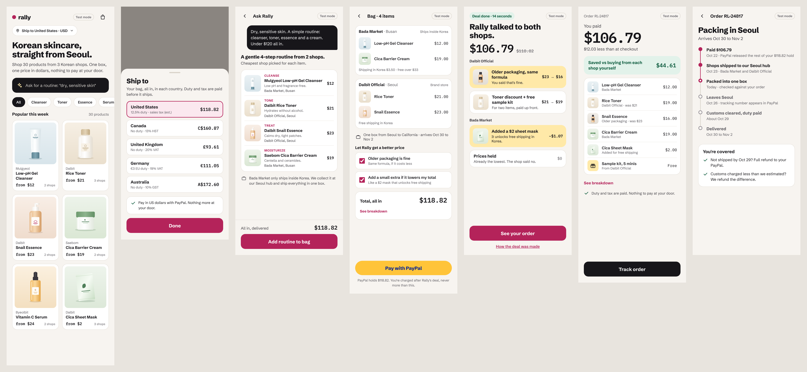

# Rally mockup (version 2)

Reference screens for the design track, exported from the mockup canvas on Oct 22, 2026. They set the flow, copy, hierarchy and numbers. The build should look better than this, not identical.

- `screens/*.png`: renders at 2x (shopper screens 390 px wide, pages 1280 px wide).
- `html/*.html`: static HTML for each screen; open `html/index.html`. Fonts load from Google Fonts.
- `html/img/*.svg`: fallback product illustrations. Replace them with real product imagery (PLAN.md, "Design direction").
- Every number comes from `design/scenario/seoul.py` (output: `design/scenario/scenario.json`).
- The copy is product copy. Keep it real: no "Example", "preview", "fixture", "simulated" or "demo" in the UI. The only sandbox marker is the "Test mode" pill.

| Screen | File | Who sees it |
| --- | --- | --- |
| 1 · Shop | `1-shop` | Shopper |
| 1b · Ship to (sheet) | `1b-ship-to` | Shopper |
| 2 · Ask Rally | `2-ask-rally` | Shopper |
| 3 · Bag and checkout | `3-bag` | Shopper |
| 4 · Deal | `4-deal` | Shopper |
| 5 · Paid | `5-paid` | Shopper |
| 6 · Track | `6-track` | Shopper |
| How the deal was made | `deal-room` | Shopper (one tap away), judges |
| Shop console | `shop-console` | Shop (private), judges read-only |
| Scorecard | `scorecard` | Judges |
| Who decides what | `who-decides` | Judges |
| Benchmark | `benchmark` | Judges (empty until the benchmark runs) |

Shops, brands and products are fictional. The retired group-order mockup is in git history before commit `0576a61`.
