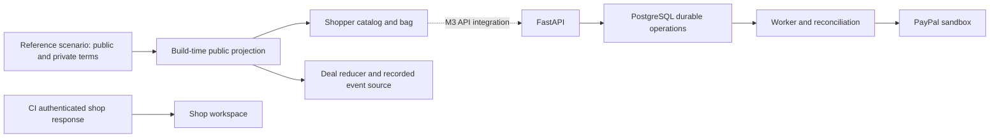

# Rally v2: implementation boundaries

The current authorized work is GD2 (design) in parallel with G1 (real PayPal proof). [PLAN.md](../PLAN.md) defines the later engine, API, operations and judge gates. Its architecture drawing is the target, not evidence those modules have shipped.

## Implemented frontend

One public scenario adapter supplies product IDs, public shop prices, destination rates and the saved hero events. Money is integer minor units with explicit currency. Bag rules express permission; they do not establish a negotiated price or buyer consent. The quote display reproduces all five saved country schedules. Category filters, restrictions, country changes and bag edits are interactive.

The Deal reducer consumes stable ordered events, deduplicates repeats and supports replay. A recorded event source is enabled only by the compile-time CI harness plus its explicit URL entry. Presentation pacing never calls a payment endpoint. Reduced motion removes price-track sliding. Completed playback cannot establish a capture; live event persistence and recovery belong to M3.

Ordinary builds require actual order data before displaying a receipt or tracking history. The current checkout remains unavailable pending M3. Shop workspace data comes through a scoped API adapter; the ordinary unconnected view is locked. CI fulfills that contract from a test fixture. No private floor, cost or test workspace payload is part of the public production bundle. The UI is not an authentication boundary: the future server must enforce shop scope independently.

`frontend/scripts/project-scenario.mjs` generates the public JSON with an explicit allow-list. Build checks reject imports of raw `design/scenario` data or `tests/fixtures` into the browser dependency graph. Public projection freshness is checked before rendered verification.

## Existing payment foundation

FastAPI, PostgreSQL, the worker, the existing LLM adapter and the durable PayPal ledger are retained. Every money mutation uses the ledger's stable logical operation and provider idempotency key. Pending/unknown responses remain unresolved until reconciliation. Webhooks retain verification, deduplication and recovery behavior. No UI timer or model callback can confirm payment.

Migration `002_hold_currency.sql` adds `holds.currency`, defaulting existing rows to USD and accepting USD/CAD/GBP/EUR/AUD. Requests record non-USD currency; authorization, capture, void and refund inherit the original payment currency. Explicit mismatches fail before provider mutation. Legacy omitted-USD request identities retain their original shape, and shop payouts remain USD. Existing schema, public tables, payment operations and purchase records are not deleted or rewritten.

The old pool/member domain remains for existing operations and the G1 capability probe. Replacing its purchasing domain is M2/M3 work after G1. New catalog/bag/order/negotiation/shipments tables listed in PLAN.md are not yet implemented. The frontend's recorded events are not a durable live negotiation log.

## Unproven and pending

- G1 needs a host reaching PostgreSQL and PayPal, three explicit buyer approvals, a successful payout and a genuine reconciled webhook. CAD marked pending does not pass.
- M2 must replace cheapest-unit reference sourcing with exact lowest-all-in search. Those can pick different shops, including for the Canadian hero bag; reconcile the saved fixture and engine golden expectations before G2.
- M3 supplies real scoped sessions, quotes, checkout, model decisions and the persisted SSE deal stream. The existing LLM adapter being present does not mean the v2 agents run.
- M4 supplies hub operations, payouts/tracking, refund deadlines and benchmark results. The current tracking display is a test contract, not carrier evidence.
- Destination duty/tax/FX values are dated scenario assumptions. Their presence in the fixture does not verify customs rules or constitute a live rate service.

See [DEMO.md](DEMO.md) for reproducible checks and [EVIDENCE.md](../EVIDENCE.md) for execution records.
