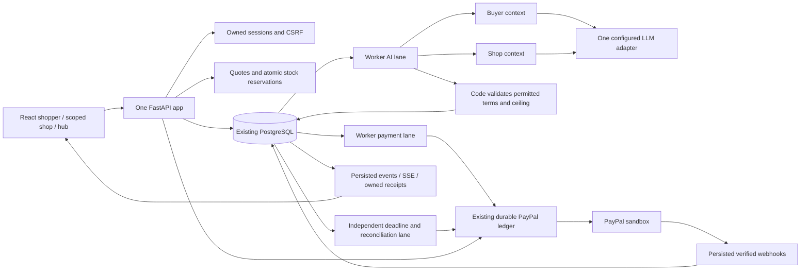

# Rally v2 architecture and data model

[PLAN.md v2](../PLAN.md) is authoritative. Implementation is complete for the connected shopping and operations surfaces; [EVIDENCE.md](../EVIDENCE.md) distinguishes local doubles, genuine G1 proof and the still-open hosted gates.

One web service, one worker process with separate AI/payment/maintenance threads, and the existing database. No broker, vector database, additional agent framework or service. SQL transactions finish before external requests. Durable job leases and immutable operation keys survive restart; SIGTERM stops new work and allows a bounded drain.

## Modules

| Module | Responsibility |
| --- | --- |
| catalog, countries, fx, landed, sourcing | Server-owned stock/policies; restrictions; dated complete cost schedules; integer rounding; exact all-in search over at most 3^8 assignments |
| assistant | Catalog-only routine proposals, stock validation and explicit budget checks; honest outage fallback |
| negotiation | Separate buyer/shop proposal contexts; executable candidates; private utility checks; at most three replies/shop, 30 seconds, bounded calls/tokens |
| sessions, shopping, orders | Owned HttpOnly sessions, CSRF/origin guards, quotes, immutable consent, reservations, SDK approval, receipt/history and SSE |
| payments, toolkit, worker, maintenance | Durable logical operations, signature verification, reconciliation, capture/void/refunds, separate processing lanes and deadlines |
| fulfillment, workspaces | Shop-scoped products/policies/deals, hub handoff/payout, export tracking, import true-up and operator recovery |
| legacy | Original-cookie owned historical receipts and hub-only read-only recovery; retired checkout returns 410 |
| sim | Seeded synthetic bags and no-payment A–D benchmark; cached model B/D only when explicitly requested |

## Persistent data

Migration `003_shopping.sql` adds the following; migrations 001/002 and every original `public` table remain intact.

| Entity | Key relationships / immutable data |
| --- | --- |
| shopper_sessions | Hashed random cookie, role/shop scope, read-only flag, expiry; no payment credentials |
| catalog_products / catalog_offers / shop_policies | Public metadata separate from private costs/floors/stock and permitted policies |
| bags → quotes | Owned items/country/rules; versioned complete terms, exact lines, locked FX, merchant, all-in breakdown, 15-minute expiry |
| orders | Unique quote, owner and legacy ledger bridge; separate payment/fulfillment states; final terms, provider order, ship-by deadline |
| order_reservations | Unique order/offer, one unit; reserved → consumed or released exactly once |
| deal_events | Stable UUID and unique per-order sequence; immediately committed; restored/deduplicated live and on replay |
| order_shipments | Separate shop→hub and hub→shopper legs; simulated flag; carrier/tracking independent of payment |
| order_shop_payments | One order/shop payout, amount in USD, stable existing-ledger scope |
| true_ups | Immutable actual import total and nonnegative refund; no extra charge |
| tracking_operations | Immutable tracking body and stable logical key; unknown outcomes use order GET before any recovery |

The existing pools/members tables are internal ledger compatibility records, not active group purchasing. Old G1 operations retain their original identities. No domain rewrite changes a historical consent, receipt or pending operation. Original Coalition records remain in `public`; unknown operations without provider IDs require provider activity review, never blind mutation.

## Payment and recovery boundaries

Checkout binds a specific owned quote and atomically reserves its stock before creating an AUTHORIZE order. Server approval verifies the provider's APPROVED order, merchant, owner, amount and currency before authorizing. Eligible authorization is required before negotiation. A canceled checkout closes the ledger authorization gate, including after pre-mutation failures.

Code validates all final terms, updates inventory and enqueues a capture atomically. Capture is final and at most the approved ceiling, promptly after negotiation and within the authorization honor period. Only confirmed capture releases fulfillment. Definitive capture failure voids the hold; ambiguity remains Needs review and is reconciled before retry. Deadline refunds reserve the unrefunded capture balance and block export. Pending refunds remain pending; successful refunds are distinct from uncaptured amounts.

Shop handoff enqueues one USD payout per shop. Export requires every shop arrival and confirmed payout. PayPal Agent Toolkit's tracking handler is called through a guarded transport using the current Orders v2 tracking endpoint; tracking itself has a durable operation. `RALLY_AUTO_FULFILLMENT=1` opts into fictional scheduled arrivals after one minute, export after two, and delivery after four, subject to those same guards. It is off by default. No webhook establishes a parcel movement.

Official references rechecked October 23: [SDK v6 client-ID setup](https://developer.paypal.com/sdk/js/set-up/), [29-day authorization and three-day honor period](https://developer.paypal.com/payment-methods/auth-honor/), [final capture](https://developer.paypal.com/api/payments/v2/authorizations-capture/), [void](https://developer.paypal.com/api/payments/v2/authorizations-void/), [refund](https://developer.paypal.com/api/payments/v2/captures-refund/) and [idempotency](https://developer.paypal.com/api/rest/reference/idempotency/). Rally captures promptly inside the honor period, sets final_capture true, and retains application operation keys beyond provider retention. Reconciliation precedes any ambiguous retry; the provider's limited idempotency retention is not treated as permanent protection.

## Privacy and frontend

Public endpoints never return floors, costs, recipient emails or provider secrets. Shop credentials expose only that shop's data; the judge password is read-only. Hub credentials provide operational recovery, not secret access. Logs use exception types, not raw provider payloads. API responses are not cached; credentials remain server-side.

Production URLs use real API contracts. The explicit compile-time review harness plus `?test=recorded` is the only recorded shopper path. Private test fixtures are absent from the production dependency graph; AG Grid is lazily loaded for the private products page. SDK v6 callbacks request server verification, never mark an order paid. Durable event reducers handle duplicates, batching, refresh, reduced motion, pause and replay without driving payments.

The Rootlane environment remains an approved static review only. The existing Render services have not been cut over; [RENDER.md](RENDER.md) gives the exact reviewable settings diff. Import/FX schedules remain fictional estimates with dated source links, not verified customs calculations.
